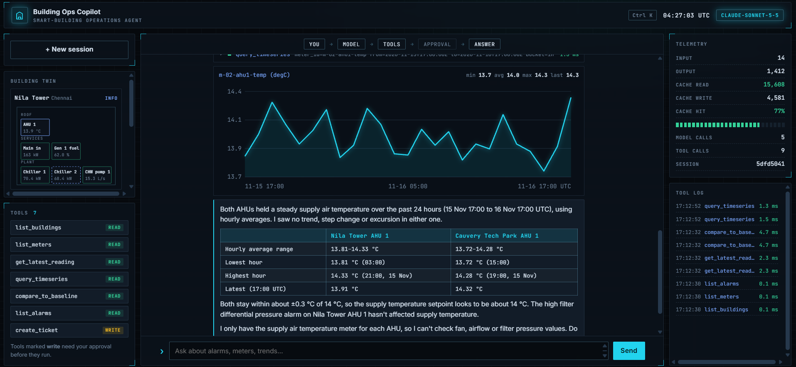
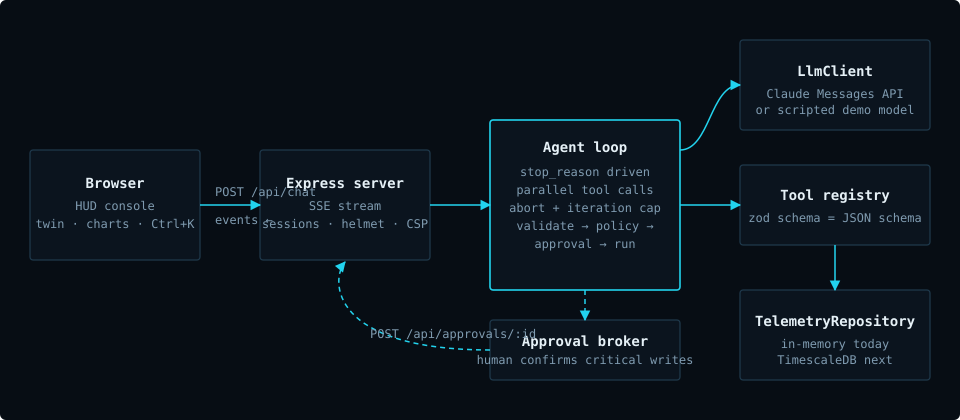
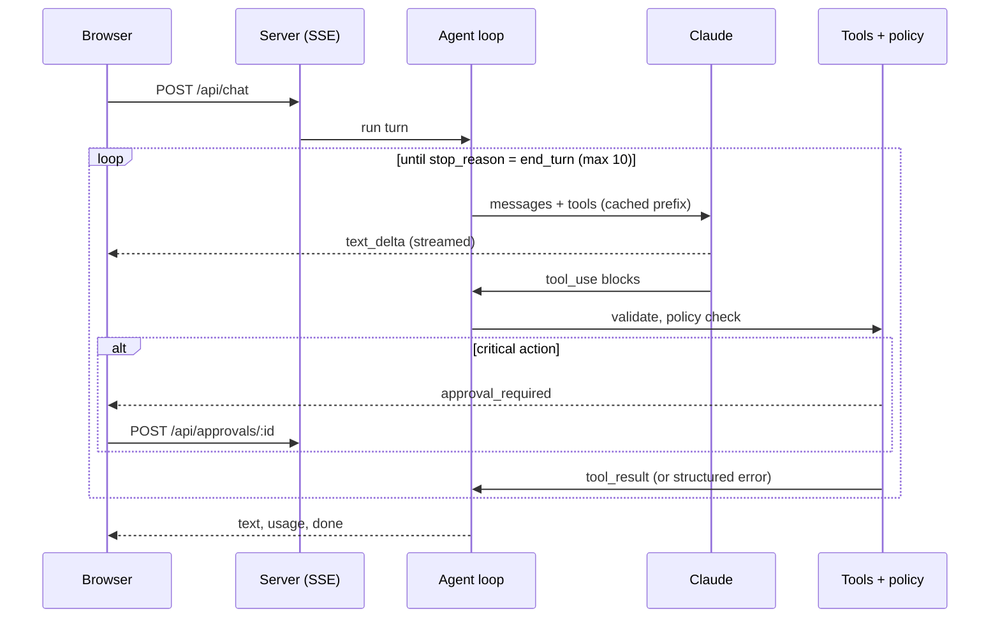

# Building Ops Copilot

[](https://github.com/capt-jack-21/building-ops-copilot/actions/workflows/ci.yml)


[](LICENSE)

An AI operations agent for smart buildings, built directly on the **Claude Messages API** (no agent framework). Ask it why a chiller tripped overnight, whether generator fuel is low, or to raise a ticket. It queries telemetry and alarms through typed tools, shows every tool call live, and asks a human before doing anything critical.



**Runs with no API key.** Without one it starts in demo mode with a scripted stand-in model, so you can explore the whole UI, the tool trace and the approval flow for free.

## Features

- **Tool-use loop driven by `stop_reason`**, with parallel tool calls, an iteration cap and cancellation (`AbortSignal`).
- **Typed tools**: each is defined once with a zod schema that both validates input and generates the JSON schema Claude sees.
- **Policy gate and human approval**: validate → policy → approval → run. Critical tickets pause the loop until a person approves in the UI. The gate fails closed.
- **Prompt caching** on tools, system prompt and conversation, with cache read/write tokens shown live (about 90% cheaper on repeat sessions).
- **Token streaming** over SSE, including mid-stream Stop.
- **HUD console**: live tool trace, inline charts, a building twin whose status comes from alarms and pulses when a tool reads a meter, and a Ctrl+K command palette. Vanilla JS, no build step.
- **Safe by construction**: model output is rendered with DOM APIs only (never `innerHTML`), strict CSP (`script-src 'self'`), rate limiting, server-generated session tokens.
- **Swappable seams**: `LlmClient` (real or demo) and `TelemetryRepository` (in-memory now, TimescaleDB next).

## Architecture



How one question flows through the loop:



## Tools

| Tool                  | Risk  | Purpose                                              |
| --------------------- | ----- | ---------------------------------------------------- |
| `list_buildings`      | read  | Buildings and their assets                           |
| `list_meters`         | read  | Meters for a building or asset                       |
| `get_latest_reading`  | read  | Most recent value for a meter                        |
| `query_timeseries`    | read  | Bucketed history for a meter (feeds the charts)      |
| `compare_to_baseline` | read  | A recent window of a meter against its baseline      |
| `list_alarms`         | read  | Alarms by building, severity, activity, age          |
| `create_ticket`       | write | Raise a ticket; **critical** priority needs approval |

Adding one is a single file plus one registration line. See [`src/tools/listAlarms.ts`](src/tools/listAlarms.ts), or use the `/add-tool` command in Claude Code.

## Quick start

Requires Node 22.

```bash
git clone https://github.com/capt-jack-21/building-ops-copilot.git
cd building-ops-copilot
npm install
cp .env.example .env      # optional: add ANTHROPIC_API_KEY for real mode
npm run dev               # http://127.0.0.1:3000
```

No key set means demo mode. Add `ANTHROPIC_API_KEY` to `.env` for real mode. `DEMO_MODE=1` forces demo even when a key exists.

Try: _"Any active alarms?"_, _"Show chiller 2 power for the last 24 hours"_, _"Create a critical ticket for the chiller trip"_ (approval card), or press **Ctrl+K**.

### Docker

```bash
docker build -t building-ops-copilot .
docker run --rm -p 3000:3000 -e DEMO_MODE=1 building-ops-copilot
# real mode: docker run --rm -p 3000:3000 --env-file .env building-ops-copilot
```

## Development

```bash
npm run verify     # typecheck + eslint + prettier check + tests
npm test           # runs every offline check script via vitest
```

The tests need no API key and no network: they run the real server, tools and loop against the demo model. CI runs the same commands.

The data is a seeded simulation (two buildings, 16 meters, 7 days at 15-minute resolution, a planted chiller trip and a falling fuel level), generated in [`src/data/seed.ts`](src/data/seed.ts).

## Design decisions

- **No agent framework.** The loop is a single readable file (`src/agent/loop.ts`) and shows exactly what the API does.
- **One schema, two jobs.** zod validates model input and produces the JSON schema, so they cannot drift.
- **Errors are data.** Tool failures return structured `{category, retryable, message}` results the model can act on; `executeTool` never throws.
- **Unfinished turns are dropped, not repaired.** A cancelled or truncated turn is not added to history, so the conversation never contains a dangling `tool_use`.
- **Events, not callbacks, at the edge.** The loop emits typed `AgentEvent`s; the CLI and the web UI are two renderers of the same stream.

## Roadmap

- TimescaleDB repository behind the existing `TelemetryRepository` interface
- Alarm acknowledgement and ticket listing tools
- Evaluation set for tool selection and answer quality
- MCP server exposing the tools

## Credits

Interface fonts are bundled under the SIL Open Font License 1.1: [Inter](https://rsms.me/inter/) and [JetBrains Mono](https://www.jetbrains.com/lp/mono/).

## License

[MIT](LICENSE)
